# TimeTracker

**Your time, your todos, your notes — on your Mac, and nowhere else.**

TimeTracker is a fast, keyboard-friendly desktop app for consultants and developers who bill by the hour. Log time against customers, projects, and issues; run your week from a kanban board; keep markdown notes next to the work; and get a month-end report you can paste straight into an invoice.

No account, no cloud, no subscription, no telemetry. Everything lives in one SQLite file in your home directory.

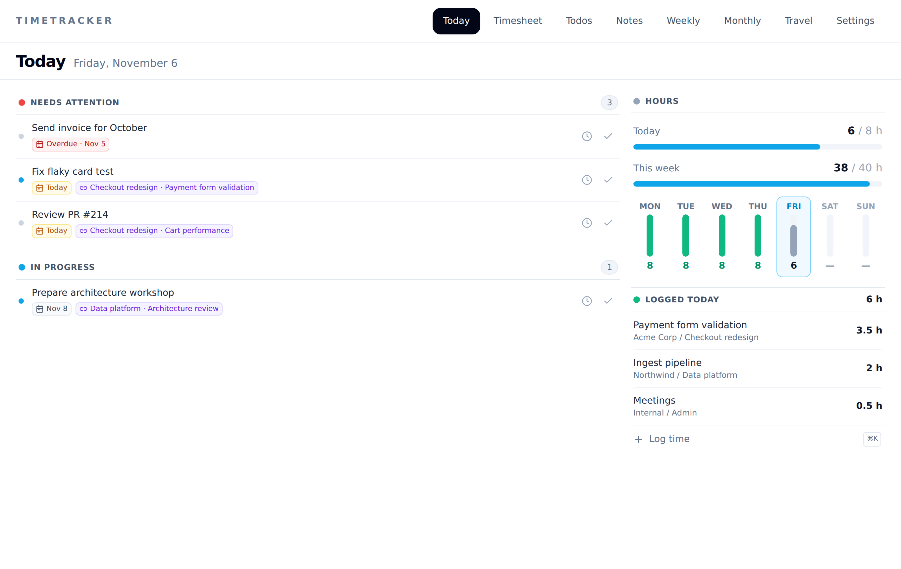

## Why TimeTracker

- **Local-first, private by default.** All data is stored in `~/.timetracker/timetracker.db` on your machine. The app makes no network calls for your data and works fully offline.
- **Yours to keep.** Plain SQLite plus one-click JSON export. Automatic daily backups on startup, with configurable retention.
- **Built for the workflow, not the database.** A Today agenda, a drag-and-drop board, and a ⌘K command palette replace form-filling.
- **Native and lightweight.** A Tauri 2 app with a Rust backend: small binary, quick start, low memory.
- **Light and dark.** Follows the system appearance, or pick one.

## A tour

### Today — start the day here

Overdue and due-today todos, what's in progress, hours logged today, and a Mon–Sun strip showing progress against your daily target. Complete a todo or log time on it in one click.

| Light | Dark |
| --- | --- |
|  | 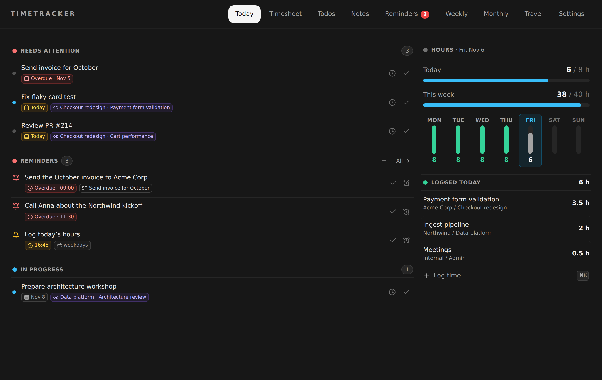 |

### Command palette — do anything with ⌘K

Log time, create a todo or note, jump to any page, or search notes without touching the mouse. It remembers your last project and issue, so a time entry is a few keystrokes. The shortcut is configurable.

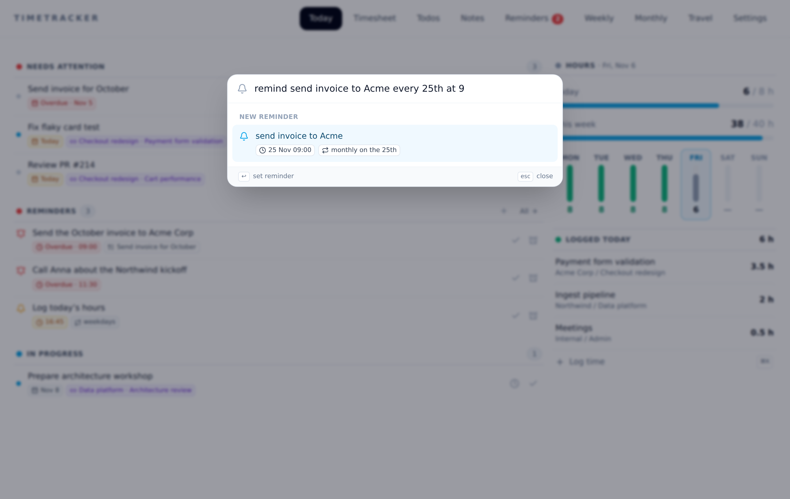

### Timesheet — every entry, editable inline

Add, edit, and delete entries in place, with pickers for customer → project → issue. Filter by day, week, month, or a custom range; the toolbar shows the period total.

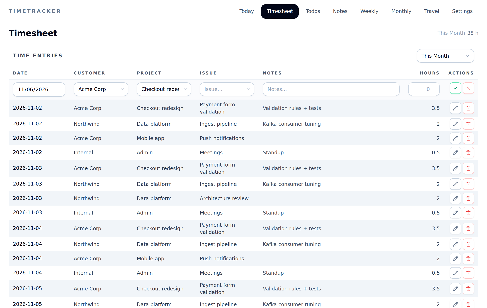

### Todos — a kanban board, not a table

Drag cards between *Not started*, *In progress*, and *Done*. Due dates turn amber for today and red when overdue. Link a todo to an issue (or create the issue from the card) so it's one click from logging time.

| Light | Dark |
| --- | --- |
| 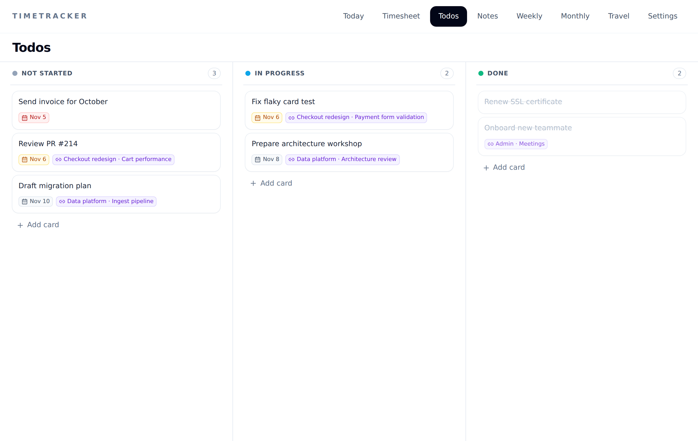 | 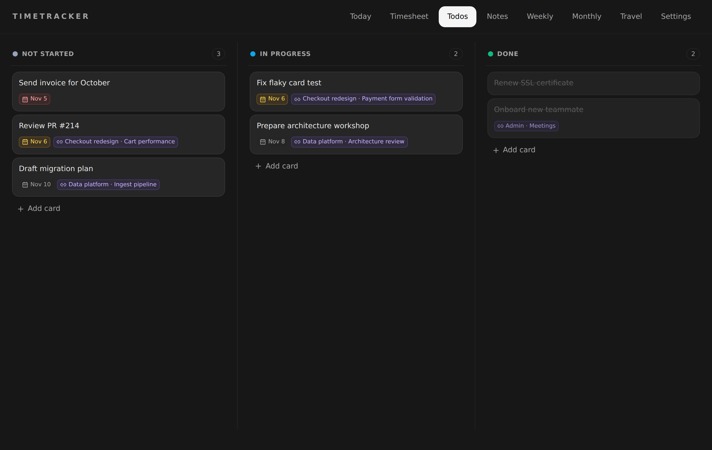 |

### Notes — markdown with live preview

Notes with a live-preview editor: headings, task lists, quotes, and syntax-highlighted code render as you type. Organise them in nested folders with drag and drop or a right-click menu, link notes with `[[wikilinks]]` and see what links back, and tag them with `#tags` — including your customers, projects, issues, and todos, which show up as live chips. Pin the important ones, search (or filter by `#tag`) everything with ranked full-text search and highlighted matches, optionally adding meaning-based results from a downloaded on-device model (Settings › Preferences), switch to a clean read view, and copy a note as HTML for email or chat. Edits save automatically, including on quit.

| Light | Dark |
| --- | --- |
| 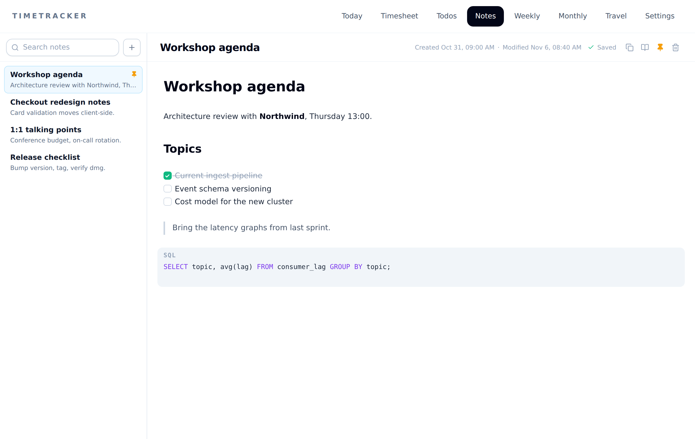 | 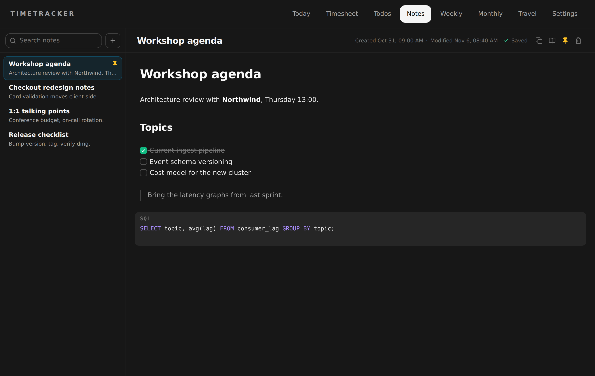 |

### Weekly report

An ISO-week grid grouped by customer and project, with per-day and per-issue totals.

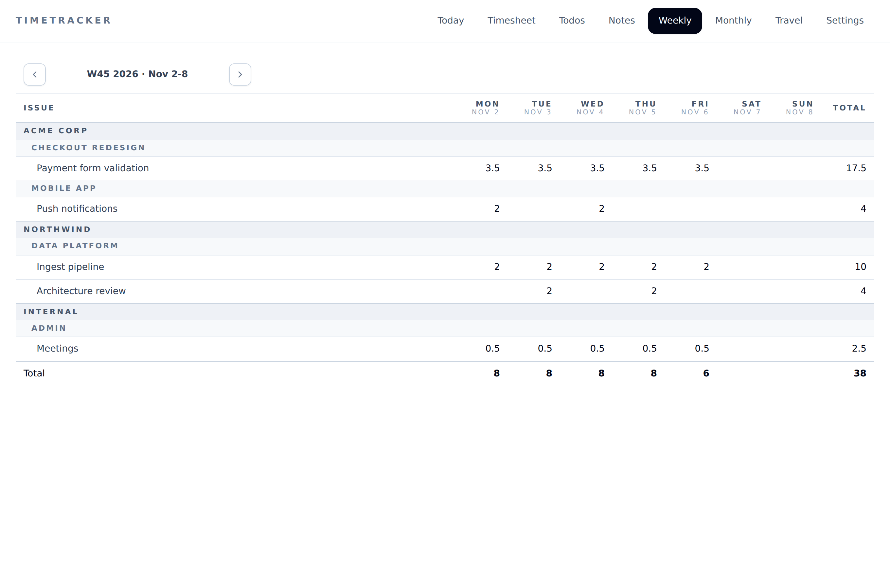

### Monthly report — invoice-ready

Hours per customer, project, and issue, with expandable groups and the month's travel. Copy a project or the whole month as text for your invoice or client portal.

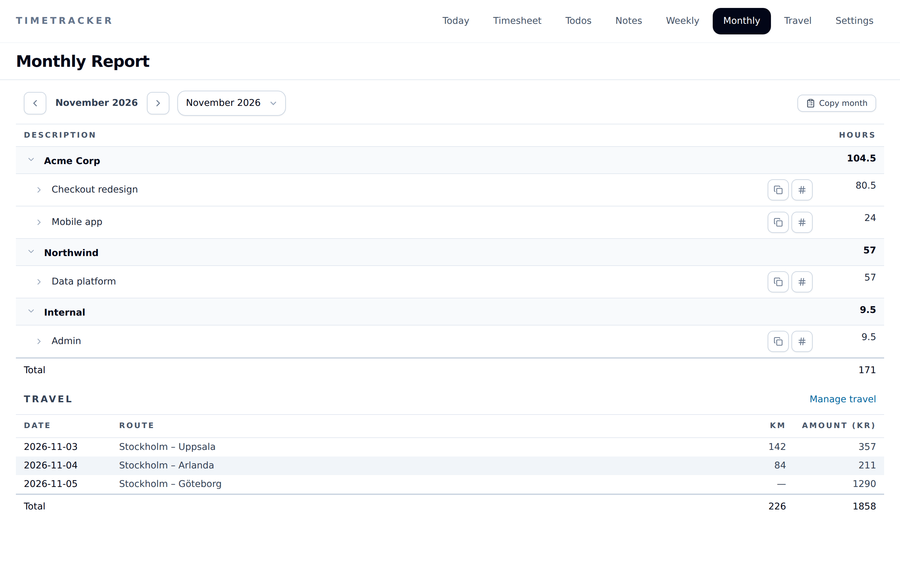

### Travel

Log business trips (date, from/to, km, amount) per month. Places autocomplete, and a trip can be repeated with one click. Totals feed into the monthly report.

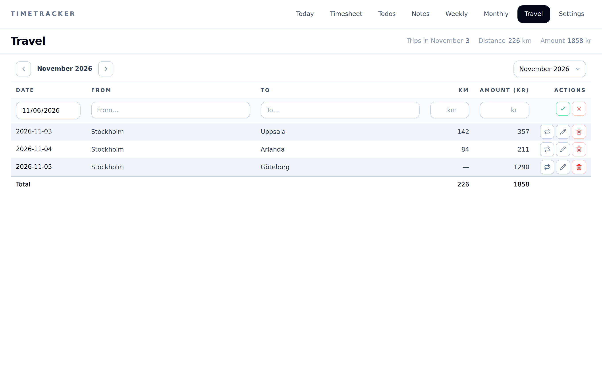

### Settings

Manage customers and projects as cards, with defaults that pre-fill new entries. Preferences cover appearance, daily hours target, the palette shortcut, and the search index. Backup & Restore exports to JSON, restores from a file, and lists automatic startup backups.

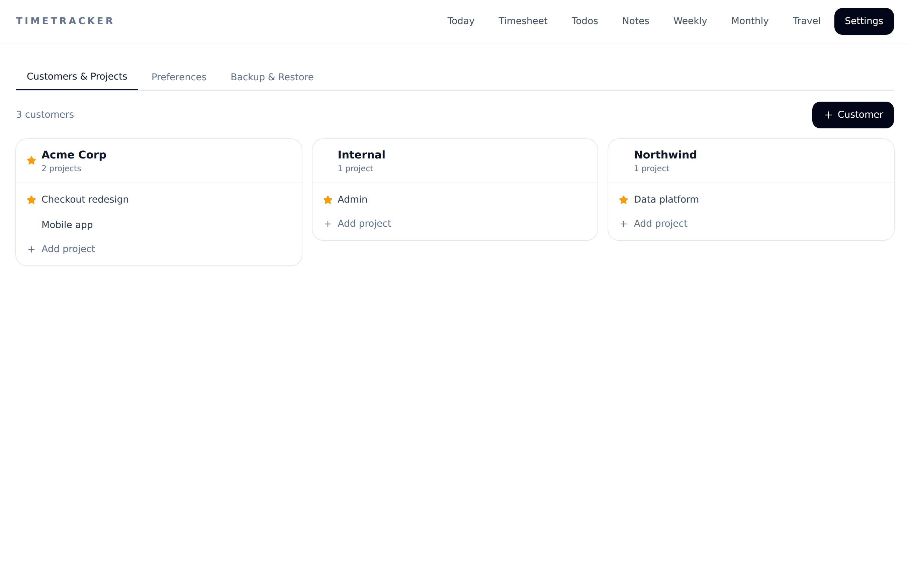

> Screenshots show sample data, rendered from the built frontend with a mocked backend.

## Your data

| What | Where |
| --- | --- |
| Database (installed app) | `~/.timetracker/timetracker.db` |
| Database (dev builds) | `.timetracker-dev/` in the repo |
| Manual backups | JSON file, wherever you save it |
| Automatic backups | Daily on startup, kept for a configurable number of days |

Restore replaces the current data with the backup's contents. See [Data and backup](docs/data-and-backup.md) for the schema and backup format.

## Install (macOS)

Pre-built `.dmg` releases are published automatically on every push to `main`.

1. Go to the [Releases](../../releases) page and download the latest `.dmg`.
2. Open the `.dmg` and drag **TimeTracker** into your `Applications` folder.
3. On first launch macOS blocks the app because it is unsigned. Remove the
   Gatekeeper quarantine flag from a terminal:

   ```bash
   xattr -dr com.apple.quarantine /Applications/TimeTracker.app
   ```

   Then open the app normally. If macOS still reports the app as "damaged",
   re-sign it ad-hoc and retry:

   ```bash
   codesign --force --deep --sign - /Applications/TimeTracker.app
   xattr -dr com.apple.quarantine /Applications/TimeTracker.app
   ```

The build is arm64-only (Apple Silicon) and unsigned/un-notarized, which is why
the quarantine step above is required.

## Development

```bash
npm install
npm run dev
```

This starts the Vite dev server and launches the Tauri shell against it. Development runs store their SQLite database and logs under repo-local `.timetracker-dev/`, isolated from the live `~/.timetracker/` data used by release builds.

**Stack:** SvelteKit SPA (Svelte 5, Tailwind) in a Tauri 2 WebView, with a Rust backend that owns a SQLite database via sqlx.

| Command | Purpose |
| --- | --- |
| `npm run dev` | Run the desktop app in development mode |
| `npm run build` | Build the production app bundle |
| `npm run check` | Run Svelte and TypeScript checks |
| `npm run lint` | Run frontend linting |
| `npm run format` | Format the repo with Prettier |
| `node --test tests/*.mjs` | Run frontend unit tests |
| `cargo test` | Run Rust unit tests |
| `cargo clippy --all -- -D warnings` | Run Rust linting |
| `cargo fmt --check` | Check Rust formatting |
| `make build` | Build the macOS app bundle |
| `make install` | Copy the built `.app` into `/Applications` |

```text
src/              SvelteKit frontend
src-tauri/        Rust Tauri backend
assets/           App assets used by the project
docs/             Documentation and screenshots
```

## Documentation

- [Getting started](docs/getting-started.md)
- [Architecture](docs/architecture.md)
- [Configuration](docs/configuration.md)
- [Data and backup](docs/data-and-backup.md)
- [Development notes](docs/development-notes.md)
- [Roadmap](docs/roadmap.md)
