# Badger

**Your time, your tasks, your notes — on your Mac, and nowhere else.**

Badger is a fast, keyboard-friendly desktop app for consultants and developers who bill by the hour. Log time against customers, projects, and issues; track tasks with reminders that follow you to your iPhone; keep markdown notes next to the work; and get a month-end report you can paste straight into an invoice.

No account, no cloud, no subscription, no telemetry. Everything lives in one SQLite file in your home directory.

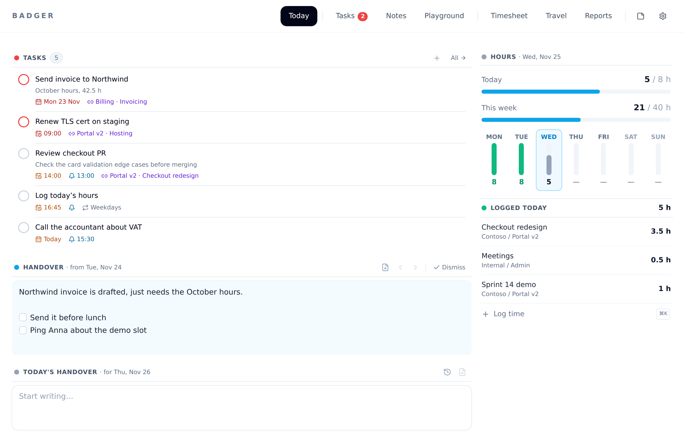

## Why Badger

- **Local-first, private by default.** All data is stored in `~/.badger/badger.db` on your machine. The app makes no network calls for your data and works fully offline.
- **Yours to keep.** Plain SQLite plus one-click export to a gzipped JSON file. Automatic daily backups to a folder you choose (iCloud Drive or Dropbox for off-site copies), optionally encrypted with `age`.
- **Built for the workflow, not the database.** A Today agenda, a date-grouped task list, and a ⌘K command palette replace form-filling.
- **Native and lightweight.** A Tauri 2 app with a Rust backend: small binary, quick start, low memory.
- **Light and dark.** Follows the system appearance, or pick one.

## A tour

### Today — start the day here

Overdue and due-today tasks (and any with a reminder that went off), hours logged today, and a Mon–Sun strip showing progress against your daily target. Complete a task or log time on it in one click. At the bottom, write a handover: a short markdown note to your future self at the end of the day (⌘K *Write handover*). It shows up above the editor on your next working day (Monday after a weekend), where you can tick its tasks, dismiss it, or page back through older ones.

| Light | Dark |
| --- | --- |
|  | 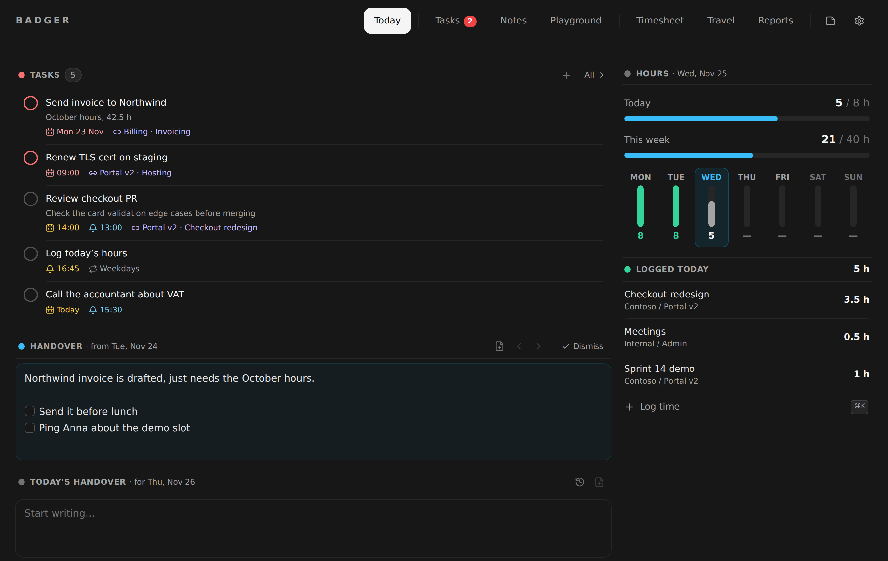 |

### Command palette — do anything with ⌘K

Log time, create a task or note, jump to any page, or search notes without touching the mouse. It remembers your last project and issue, so a time entry is a few keystrokes. The shortcut is configurable.

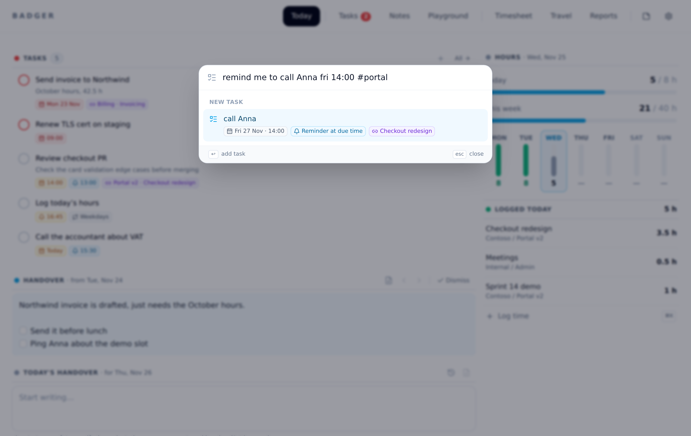

### Timesheet — every entry, editable inline

Add, edit, and delete entries in place, with pickers for customer → project → issue. Filter by day, week, month, or a custom range; the toolbar shows the period total.

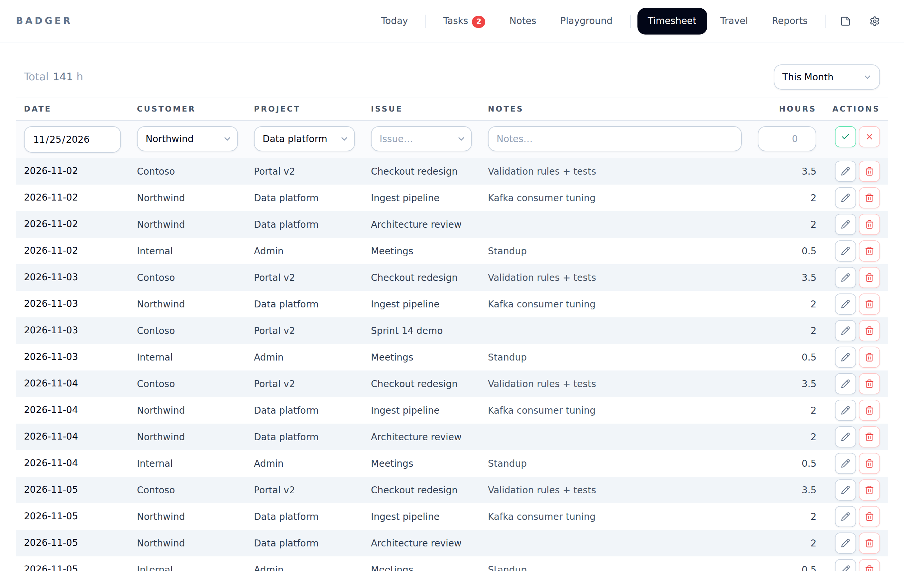

### Tasks — shaped like an Apple reminder

A task is open or done, with an optional due date and time and up to ten reminders (at the due time, 15 minutes, an hour, a day or a week before, or at a time you pick). Tasks are grouped Overdue, Today, Tomorrow, This week, Later and No date, with a folded *Completed* group. A scope filter above the list (*All*, *Today*, *Tomorrow*, *This week*, each with a count) narrows it to what is due then; it resets to *All* when the app restarts. Hover a row (or Tab into it) for *Schedule* (Today, Tomorrow, This weekend, Next week, No date), *Details* and a *More* menu (Complete, Delete, Copy link); the details panel opens beside the list only while a task is selected. The Today page rows have *Schedule* and *More* too. Type in the quick-add box (`Call Anna fri 14:00 #Contoso`, English or Swedish) and a live preview shows the due date, the reminder and the issue it will link to; ⌘K *New task* does the same from anywhere. Tasks can repeat daily, on weekdays, weekly or monthly, and a repeating task moves to its next date when you complete it. Link a task to an issue (or create the issue from it) so it's one click from logging time, or to a note. Completing a task plays a short animation and offers *Undo* for a few seconds.

When a reminder goes off you get a native macOS notification, or an in-app toast with *Done* and *Snooze* while the app is in front. Overdue tasks are counted on the nav tab and the dock badge, and reminders that came due while the app was closed show up on the next launch.

Optionally, turn on sync in Settings › Preferences › Apple Reminders: open tasks (except repeating ones and any you mark *Keep off phone*) sync both ways with one Reminders list, "Badger", so iCloud carries them and their alerts to your iPhone.

| Light | Dark |
| --- | --- |
| 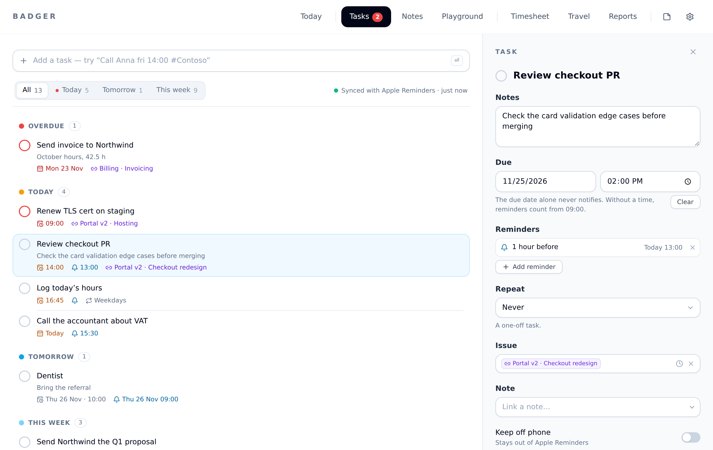 | 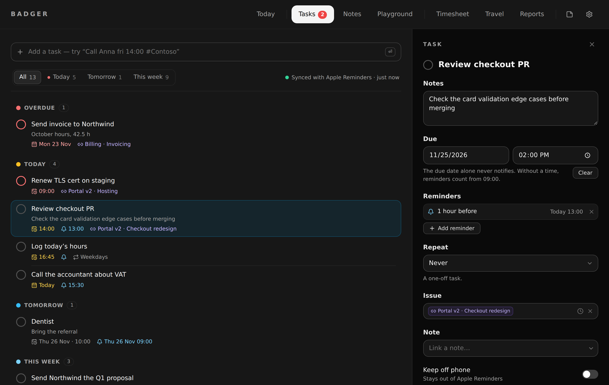 |

### Notes — markdown with live preview

Notes with a live-preview editor: headings, task lists, quotes, and syntax-highlighted code render as you type. Organise them in nested folders with drag and drop or a right-click menu, link notes with `[[wikilinks]]` and see what links back, and tag them with `#tags` — including your customers, projects, issues, and tasks, which show up as live chips. Pin the important ones, search (or filter by `#tag`) everything with ranked full-text search and highlighted matches, optionally adding meaning-based results from a downloaded on-device model (Settings › Preferences), switch to a clean read view, and copy a note as HTML for email or chat. Edits save automatically, including on quit.

| Light | Dark |
| --- | --- |
| 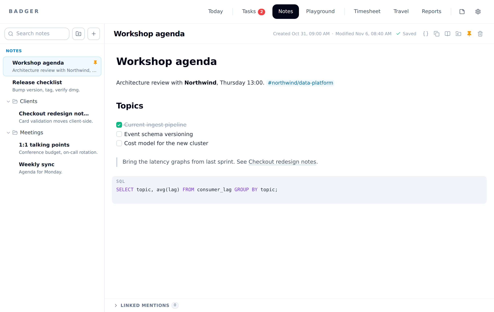 | 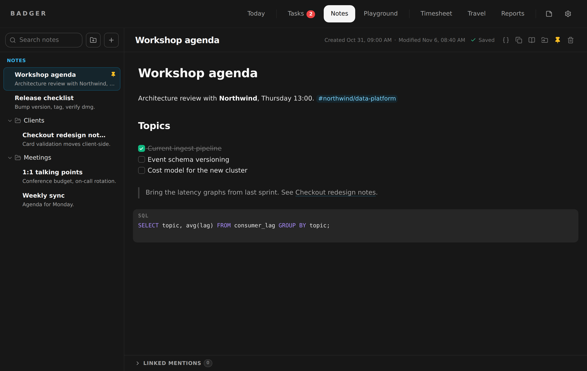 |

### Scratchpad — jot without leaving the page

Press ⌘J on any page (or pick *Scratchpad* in ⌘K, or the icon next to Settings) and a drawer slides in from the left over whatever you're doing, with the caret ready. It's one persistent pad with the same live-preview editor as notes. It saves as you type and is still there after a restart, but it stays out of search, links, and tags. When something turns out to be worth keeping, *Save as note* asks for a title and turns the whole pad into a note. You can also copy it as HTML, read it rendered with ⌘E, or clear it.

| Light | Dark |
| --- | --- |
| 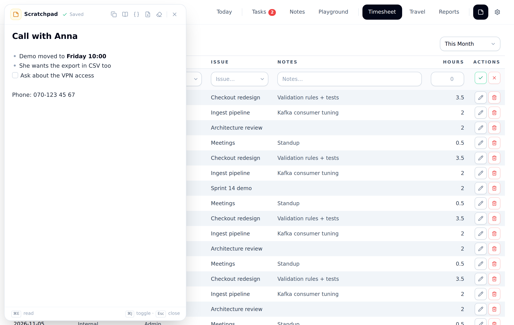 | 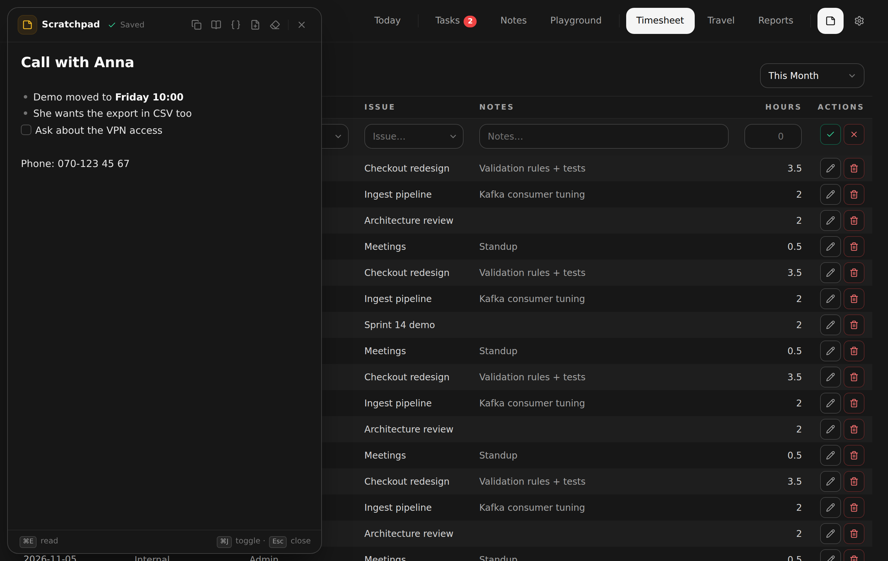 |

### Weekly report

An ISO-week grid grouped by customer and project, with per-day and per-issue totals.

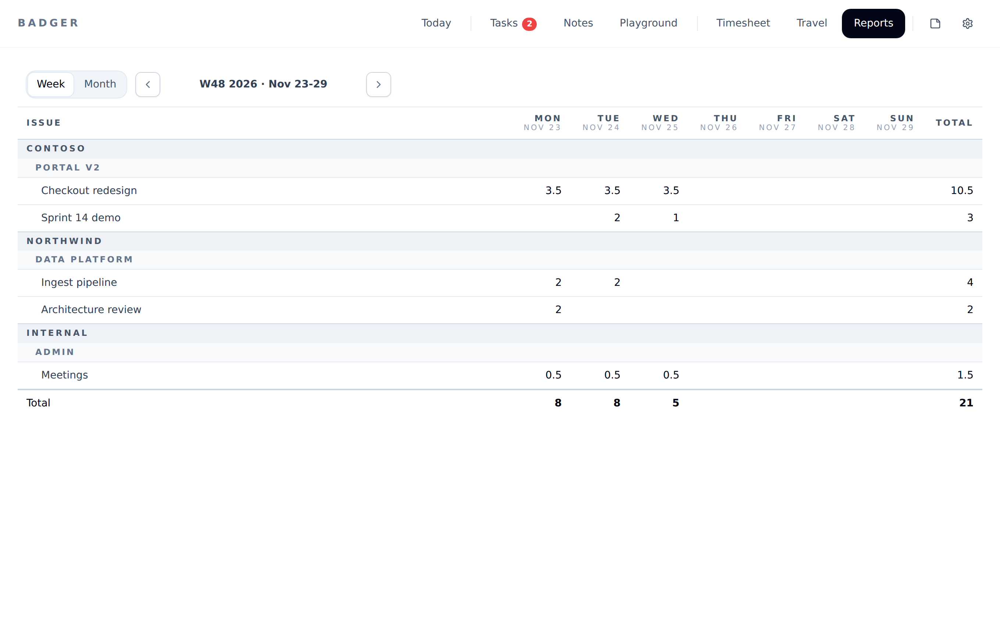

### Monthly report — invoice-ready

Hours per customer, project, and issue, with expandable groups and the month's travel. Copy a project or the whole month as text for your invoice or client portal.

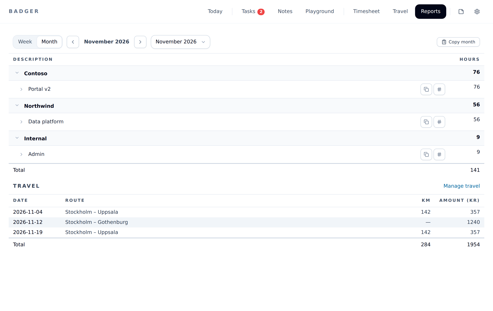

### Travel

Log business trips (date, from/to, km, amount) per month. Places autocomplete, and a trip can be repeated with one click. Totals feed into the monthly report.

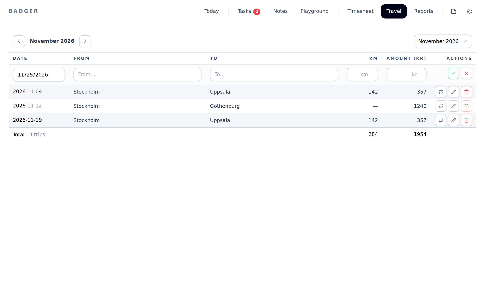

### Settings

Manage customers and projects as cards, with defaults that pre-fill new entries. Preferences cover appearance, daily hours target, the palette shortcut, and the search index. Backup & Restore exports gzipped JSON, restores from a file (`.json.gz` or older plain `.json`), and sets the automatic backups folder, encryption and retention.

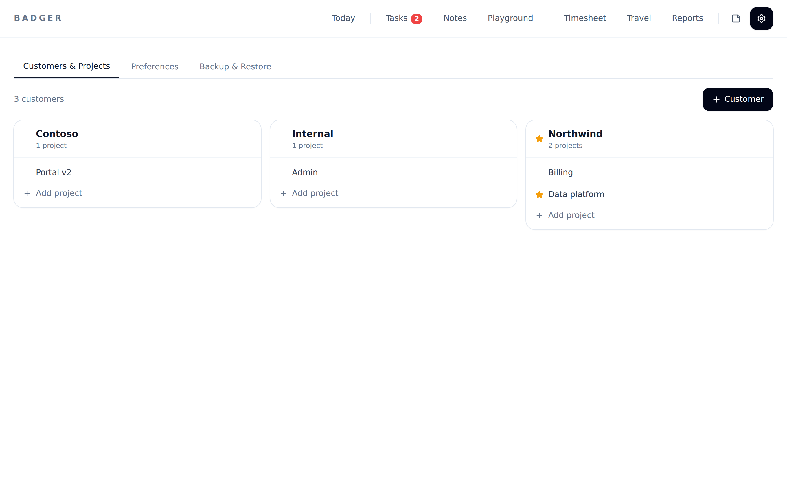

> Screenshots show sample data, rendered from the built frontend with a mocked backend.

## Your data

| What | Where |
| --- | --- |
| Database (installed app) | `~/.badger/badger.db` |
| Database (dev builds) | `.badger-dev/` in the repo |
| Manual backups | Gzipped JSON file (`.json.gz`), wherever you save it |
| Automatic backups | Daily, in a folder you choose, optionally `age`-encrypted, kept for a configurable number of days |

Restore replaces the current data with the backup's contents. See [Data and backup](docs/data-and-backup.md) for the schema and backup format.

## Install (macOS)

Pre-built `.dmg` releases are published when a `v*` tag is pushed (see [Releasing](#releasing)).

1. Go to the [Releases](../../releases) page and download the latest `.dmg`.
2. Open the `.dmg` and drag **Badger** into your `Applications` folder.
3. On first launch macOS blocks the app because it is not notarized. Remove the
   Gatekeeper quarantine flag from a terminal:

   ```bash
   xattr -dr com.apple.quarantine /Applications/Badger.app
   ```

   Then open the app normally. If macOS still reports the app as "damaged",
   re-sign it ad-hoc and retry (this replaces the release signature, so macOS
   may ask for notification permission again after the next update):

   ```bash
   codesign --force --deep --sign - /Applications/Badger.app
   xattr -dr com.apple.quarantine /Applications/Badger.app
   ```

The build is arm64-only (Apple Silicon), signed with a self-signed certificate
and not notarized, which is why the quarantine step above is required.

## Development

```bash
npm install
npm run dev
```

This starts the Vite dev server and launches the Tauri shell against it. Development runs store their SQLite database and logs under repo-local `.badger-dev/`, isolated from the live `~/.badger/` data used by release builds.

**Stack:** SvelteKit SPA (Svelte 5, Tailwind) in a Tauri 2 WebView, with a Rust backend that owns a SQLite database via sqlx.

| Command | Purpose |
| --- | --- |
| `npm run dev` | Run the desktop app in development mode |
| `npm run build` | Build the production app bundle |
| `npm run check` | Run Svelte and TypeScript checks |
| `npm run lint` | Run frontend linting |
| `npm run format` | Format the repo with Prettier |
| `node --test tests/*.mjs` | Run frontend unit tests |
| `cargo test` | Run Rust unit tests |
| `cargo clippy --all -- -D warnings` | Run Rust linting |
| `cargo fmt --check` | Check Rust formatting |
| `make build` | Build the macOS app bundle |
| `make install` | Copy the built `.app` into `/Applications` |

```text
src/              SvelteKit frontend
src-tauri/        Rust Tauri backend
assets/           App assets used by the project
docs/             Documentation and screenshots
```

### Releasing

Merging to `main` does not build anything. To publish a release, tag a commit on `main` and push the tag:

```bash
git tag v1.0.0-31   # v<version> or v<version>-<suffix>
git push origin v1.0.0-31
```

`<version>` must match `version` in `src-tauri/tauri.conf.json` (bump it there, in `src-tauri/Cargo.toml` and in `package.json` for a new version), or the workflow fails before building. The tag becomes the release name.

## Documentation

- [Getting started](docs/getting-started.md)
- [Architecture](docs/architecture.md)
- [Configuration](docs/configuration.md)
- [Data and backup](docs/data-and-backup.md)
- [Development notes](docs/development-notes.md)
- [Roadmap](docs/roadmap.md)
